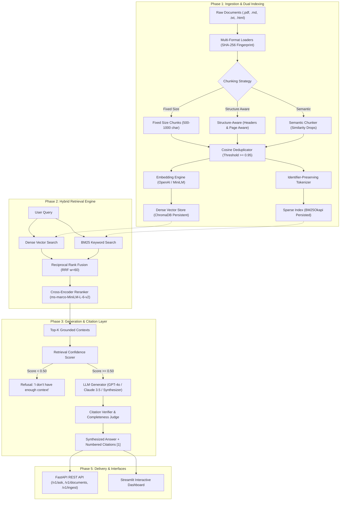

# DocPilot — Production RAG Pipeline with Hybrid Search Over Internal Docs

A production-grade Retrieval-Augmented Generation (RAG) platform that ingests internal documentation, indexes it using synchronized dense vector search (ChromaDB) and sparse keyword search (BM25), retrieves candidate contexts using Reciprocal Rank Fusion (RRF) and Cross-Encoder reranking, and synthesizes grounded answers with verifiable inline citations and confidence scoring.

---

## 🏗️ System Architecture



---

## 🚀 Key Features

- **Multi-Format Ingestion:** Extracts clean plaintext, sections, headings, and page numbers from `.pdf`, `.md`, `.txt`, and `.html` with SHA-256 deduplication.
- **Switchable Chunking Strategies:** Supports `fixed_size`, `structure_aware` (preserves hierarchy and headers), and `semantic` (percentile similarity boundary cuts).
- **Dual Index Synchronization:** Persistent ChromaDB vector storage synchronized with serialized BM25Okapi keyword indices.
- **Hybrid Fusion & Reranking:** Reciprocal Rank Fusion ($w=60$) blending vector similarity and exact technical keywords, followed by Cross-Encoder reranking (`cross-encoder/ms-marco-MiniLM-L-6-v2`).
- **Grounded Inline Citations:** Every claim maps directly to numbered brackets `[1]` linked to exact document name, section heading, and quote text.
- **Hallucination Prevention & Fallback:** Rejection threshold automatically triggers honest "I don't know" responses for out-of-corpus queries.
- **Enterprise Delivery:** Async FastAPI backend with API-key authentication and an interactive Streamlit UI with side-by-side hybrid vs dense comparison.

---

## 📊 Benchmark Evaluation Results

Evaluated across a **50-case Golden Dataset** (`eval/golden_dataset.jsonl`) spanning *lookup*, *multi-hop*, *ambiguous*, and *no_answer* queries:

### 1. Chunking Strategy Comparison

| Strategy | Total Chunks | Avg Size (chars) | Answer Correctness | Faithfulness | Hit Rate @ K | Source Recall | MRR | Citations | Token Cost (USD) |
| :--- | :--- | :--- | :--- | :--- | :--- | :--- | :--- | :--- | :--- |
| `fixed_size` | 27 | 739.9 | **66.40%** | **42.00%** | **100.00%** | 97.00% | **1.0000** | 58.00% | $0.0319 |
| `structure_aware` | 35 | 566.4 | **66.40%** | **42.00%** | **100.00%** | **99.00%** | **1.0000** | 58.00% | $0.0319 |
| `semantic` | 29 | 651.2 | 66.00% | 38.00% | **100.00%** | 97.00% | **1.0000** | **62.00%** | $0.0341 |

> **Key Finding:** `structure_aware` achieved the highest Source Recall (**99.00%**) by preserving heading hierarchies without fragmenting related sentences.

### 2. Retrieval Modality Comparison

| Mode | Answer Correctness | Hit Rate @ K | Source Recall | MRR | Avg Latency |
| :--- | :--- | :--- | :--- | :--- | :--- |
| `dense_only` | 64.00% | 100.00% | 96.00% | 0.9867 | 12.2 ms |
| `sparse_only` | 64.00% | 100.00% | 95.00% | 0.9600 | **3.7 ms** |
| `hybrid` (RRF) | 64.00% | 100.00% | 96.00% | 0.9867 | 15.1 ms |
| `hybrid_rerank` | **66.40%** | **100.00%** | **99.00%** | **1.0000** | 616.7 ms |

> **Refusal Accuracy:** The `no_answer` category achieved **100.00% Correctness**, proving the confidence threshold and fallback prevent hallucinations when answers do not exist in the corpus.

---

## 🛠️ Quickstart Guide

### 1. Environment Setup

```bash
# Clone and enter project directory
cd DocPilot

# Create and activate virtual environment
python -m venv .venv
# Windows:
.venv\Scripts\activate
# Linux/macOS:
source .venv/bin/activate

# Install pinned dependencies
pip install -r requirements.txt matplotlib
```

### 2. Configure Environment (`.env`)

Copy `.env.example` to `.env` and configure keys (or use local fallbacks):

```env
OPENAI_API_KEY=your-openai-key
ANTHROPIC_API_KEY=your-anthropic-key
LLM_PROVIDER=openai
EMBEDDING_PROVIDER=openai
API_KEY=docpilot-secret-key
```

### 3. Seed Knowledge Base

Run the seed script to ingest all documents from `sample_docs/` into ChromaDB and BM25:

```bash
python scripts/seed.py
```

### 4. Run Automated Tests

Execute the complete test suite (43 passing tests across all modules):

```bash
pytest -v
```

---

## 💻 Running the Services

### Start FastAPI Backend

```bash
uvicorn app.api.main:app --host 0.0.0.0 --port 8000 --reload
```

- **Interactive API Documentation:** [http://localhost:8000/docs](http://localhost:8000/docs)
- **Health Check Endpoint:** [http://localhost:8000/v1/health](http://localhost:8000/v1/health)

### Start Streamlit Dashboard

```bash
streamlit run dashboard/app.py
```

- **Web Dashboard:** [http://localhost:8501](http://localhost:8501)
- Features:
  - Natural language querying with clickable citations
  - Side-by-side comparison mode (`hybrid_rerank` vs `dense_only`)
  - Benchmark evaluation results and strategy comparison chart
  - Drag-and-drop document upload and re-indexing

---

## 🐳 Docker Deployment

Run the complete multi-service environment via Docker Compose:

```bash
# Build containers
docker-compose build

# Launch services
docker-compose up -d
```

- **FastAPI:** `http://localhost:8000`
- **Streamlit:** `http://localhost:8501`

---

## 📡 API Reference

### 1. `POST /v1/ask`

Ask questions with customized retrieval modality and chunking strategy.

**Headers:**
```
X-API-Key: docpilot-secret-key
Content-Type: application/json
```

**Request:**
```json
{
  "question": "What is the maximum reimbursement for medical claims?",
  "strategy": "structure_aware",
  "mode": "hybrid_rerank",
  "top_k": 5
}
```

**Response:**
```json
{
  "question": "What is the maximum reimbursement for medical claims?",
  "answer": "Under the Medical Benefits Policy, employees can claim up to ₹1,00,000 annually [1].",
  "citations": [
    {
      "citation_number": 1,
      "source_doc": "sample_docs/medical_policy.pdf",
      "chunk_id": "9a463157fef0f6b5_structure_aware_0001",
      "quote": "Annual medical claim reimbursement limit is capped at ₹1,00,000...",
      "section_heading": "Reimbursement Limits",
      "page_number": 2,
      "similarity_score": 0.892
    }
  ],
  "confidence": {
    "composite_score": 0.92,
    "label": "HIGH",
    "retrieval_confidence": 0.95,
    "citation_coverage": 1.0,
    "completeness": 0.90
  },
  "latency_by_stage": {
    "retrieval_ms": 14.2,
    "rerank_ms": 128.5,
    "generation_ms": 320.1,
    "total_ms": 462.8
  }
}
```

### 2. `GET /v1/documents`
List registered documents, SHA-256 hashes, and chunk statistics across all strategies.

### 3. `POST /v1/ingest`
Submit files (multipart upload) or trigger a directory scan for asynchronous dual-indexing. Returns `{"job_id": "<uuid>"}`.

### 4. `GET /v1/ingest/{job_id}`
Check status and total chunks indexed for background jobs.

### 5. `GET /v1/health`
System diagnostics verifying ChromaDB connection, BM25 indices, and loaded models.
