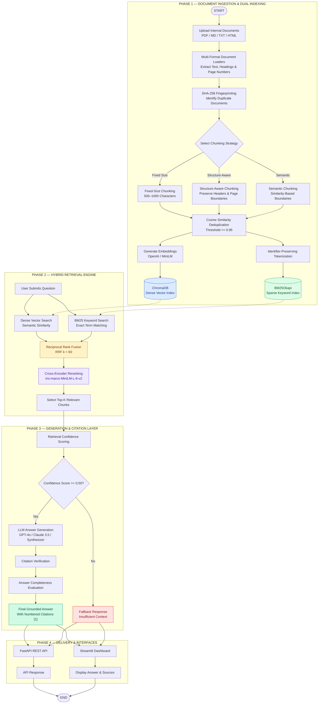

# 📚 DocPilot — Production RAG Pipeline with Hybrid Search Over Internal Docs

**DocPilot** is a production-grade Retrieval-Augmented Generation (RAG) platform that enables users to retrieve accurate, context-aware answers from internal documentation.

It combines **dense vector search (ChromaDB)** and **sparse keyword search (BM25)** with Reciprocal Rank Fusion (RRF) and Cross-Encoder reranking to retrieve highly relevant information.

The retrieved context is passed to an LLM to generate grounded answers with verifiable inline citations, confidence scoring, and an automated fallback mechanism to reduce hallucinations.

---

## ✨ Key Features

- **Multi-Format Document Ingestion:** Extracts text, headings, sections, and page numbers from PDF, Markdown, TXT, and HTML documents.
- **SHA-256 Deduplication:** Generates document fingerprints to identify duplicate files and avoid unnecessary reprocessing.
- **Multiple Chunking Strategies:** Supports fixed-size, structure-aware, and semantic chunking.
- **Dual Index Synchronization:** Maintains persistent ChromaDB vector storage alongside serialized BM25Okapi keyword indices.
- **Hybrid Retrieval:** Combines semantic vector search and keyword-based retrieval using Reciprocal Rank Fusion.
- **Cross-Encoder Reranking:** Reorders retrieved candidates using `cross-encoder/ms-marco-MiniLM-L-6-v2`.
- **Grounded Inline Citations:** Maps generated answers to numbered citations containing document names, section headings, page numbers, and supporting quotes.
- **Hallucination Prevention:** Uses a retrieval confidence threshold to trigger fallback responses when sufficient context is unavailable.
- **Confidence Scoring:** Evaluates retrieval confidence, citation coverage, and answer completeness.
- **FastAPI Backend:** Provides authenticated REST APIs for querying, document management, ingestion, and health checks.
- **Interactive Streamlit Dashboard:** Supports natural-language querying, document uploads, retrieval comparisons, and benchmark visualization.
- **Benchmark Evaluation:** Evaluates performance using a 50-case Golden Dataset.
- **Docker Support:** Supports multi-service deployment using Docker Compose.

---

## 🛠️ Tech Stack

| Technology | Purpose |
|---|---|
| Python | Core application and pipeline development |
| FastAPI | REST API backend |
| Streamlit | Interactive dashboard |
| ChromaDB | Persistent dense vector database |
| BM25Okapi | Sparse keyword retrieval |
| Sentence Transformers | Embeddings and Cross-Encoder reranking |
| OpenAI | LLM generation and embeddings |
| Anthropic Claude | Alternative LLM provider |
| Reciprocal Rank Fusion | Hybrid retrieval result fusion |
| SHA-256 | Document fingerprinting |
| Pytest | Automated testing |
| Matplotlib | Benchmark visualization |
| Docker | Containerization and deployment |

---

## 🏗️ System Architecture

DocPilot follows a multi-stage Retrieval-Augmented Generation architecture.

The system is divided into four major phases:

1. **Document Ingestion & Dual Indexing:** Loads documents, extracts text, generates fingerprints, chunks content, removes duplicates, and creates dense and sparse indexes.
2. **Hybrid Retrieval Engine:** Searches both indexes, combines their rankings using RRF, and reranks results using a Cross-Encoder.
3. **Generation & Citation Layer:** Evaluates retrieved context, generates grounded answers using an LLM, and verifies citations.
4. **Delivery & Interfaces:** Returns the final response through FastAPI and displays it through Streamlit.

### Complete System Architecture Flowchart

The following diagram represents the complete data flow through DocPilot, from document upload to the final AI-generated answer.



### Understanding the Architecture

#### Phase 1 — Document Ingestion & Dual Indexing

This phase converts raw documents into searchable information.

**1. Document Loading**

Users upload internal documents in supported formats:

- PDF (`.pdf`)
- Markdown (`.md`)
- Plain Text (`.txt`)
- HTML (`.html`)

The loaders extract text, headings, sections, and page information.

**2. SHA-256 Fingerprinting**

Each document is assigned a SHA-256 fingerprint.

This helps identify duplicate documents and avoid unnecessary reprocessing.

**3. Chunking Strategies**

Large documents are divided into smaller pieces called chunks.

DocPilot supports three approaches:

| Strategy | Description |
|---|---|
| `fixed_size` | Splits text into chunks of approximately 500–1000 characters |
| `structure_aware` | Preserves document hierarchy, headings, and page boundaries |
| `semantic` | Identifies chunk boundaries using changes in semantic similarity |

**4. Cosine Similarity Deduplication**

The system compares chunk embeddings using cosine similarity and uses a threshold of `0.95` to identify highly similar chunks for deduplication.

**5. Dual Indexing**

This is one of the most important architectural decisions in DocPilot.

Instead of relying on a single search method, the system maintains two synchronized indexes.

| Dense Index — ChromaDB | Sparse Index — BM25 |
|---|---|
| Uses numerical embeddings | Uses tokenized text |
| Understands semantic meaning | Matches keywords and identifiers |
| Finds conceptually related content | Finds exact technical terms |
| Performs vector similarity search | Performs lexical relevance ranking |

Both indexes are created from the processed document chunks.

#### Phase 2 — Hybrid Retrieval Engine

When a user submits a question, DocPilot searches both indexes in parallel.

**1. Dense Vector Search**

The question is converted into an embedding and compared against document embeddings stored in ChromaDB.

It retrieves content based on semantic similarity, even when the wording differs.

**2. Sparse Keyword Search**

BM25 searches for matching terms and keywords in the indexed documents.

This is especially useful for technical identifiers, specific names, and exact terminology.

**3. Reciprocal Rank Fusion (RRF)**

RRF combines the rankings from dense and sparse retrieval.

The formula is:

\[
RRF(d)=\sum_{r\in R}\frac{1}{k+rank_r(d)}
\]

Where:

- `d` represents a document chunk.
- `R` represents the retrieval systems.
- `rank` is the position of a chunk in a result list.
- `k` is the ranking constant, configured as `60`.

RRF allows the system to combine rankings without requiring raw similarity scores from different retrieval methods to be directly comparable.

**4. Cross-Encoder Reranking**

After RRF, the candidate chunks are evaluated using a Cross-Encoder.

The model used is:

`cross-encoder/ms-marco-MiniLM-L-6-v2`

Unlike independent embedding comparisons, a Cross-Encoder evaluates the query and candidate text together to estimate their relevance.

**5. Top-K Selection**

The system selects the most relevant chunks according to the reranked results.

For example, with `top_k = 5`, five selected contexts are passed to the generation stage.

#### Phase 3 — Generation & Citation Layer

**1. Retrieval Confidence Scoring**

Before generating an answer, the system evaluates whether the retrieved context is sufficient.

The configured threshold is `0.50`.

| Condition | Action |
|---|---|
| Confidence below `0.50` | Return fallback response |
| Confidence at least `0.50` | Proceed to answer generation |

Fallback response:

```text
I don't have enough context to answer this question.
```

**2. LLM Answer Generation**

Relevant document chunks are passed to the configured LLM provider.

Supported providers include:

- GPT-4o
- Claude 3.5
- Configured synthesizer

The model generates an answer using the retrieved documentation rather than relying only on its pre-trained knowledge.

**3. Citation Verification**

Generated answers pass through a citation verification and completeness evaluation layer.

Each citation can contain:

- Citation number.
- Original document name.
- Chunk identifier.
- Supporting quote.
- Section heading.
- Page number.
- Similarity score.

**4. Final Answer**

The system returns a grounded response with numbered citations and confidence information.

#### Phase 4 — Delivery & Interfaces

The final output is made available through two interfaces:

**FastAPI Backend**

Provides REST endpoints for:

- Asking questions.
- Listing indexed documents.
- Uploading and ingesting documents.
- Checking ingestion status.
- Checking system health.

**Streamlit Dashboard**

Provides:

- Natural-language querying.
- Clickable citations.
- Retrieval mode comparisons.
- Benchmark visualization.
- Document upload and re-indexing.

---

## 📊 Benchmark Evaluation Results

DocPilot was evaluated using a **50-case Golden Dataset** stored in `eval/golden_dataset.jsonl`.

The evaluation covers four query categories:

- `lookup`
- `multi_hop`
- `ambiguous`
- `no_answer`

### 1. Chunking Strategy Comparison

| Strategy | Total Chunks | Avg Size (chars) | Answer Correctness | Faithfulness | Hit Rate @ K | Source Recall | MRR | Citations | Token Cost (USD) |
|---|---:|---:|---:|---:|---:|---:|---:|---:|---:|
| `fixed_size` | 27 | 739.9 | **66.40%** | **42.00%** | **100.00%** | 97.00% | **1.0000** | 58.00% | $0.0319 |
| `structure_aware` | 35 | 566.4 | **66.40%** | **42.00%** | **100.00%** | **99.00%** | **1.0000** | 58.00% | $0.0319 |
| `semantic` | 29 | 651.2 | 66.00% | 38.00% | **100.00%** | 97.00% | **1.0000** | **62.00%** | $0.0341 |

**Key Finding:** `structure_aware` achieved the highest Source Recall of **99.00%**, demonstrating the benefit of preserving heading hierarchies and related sentences during chunking.

### 2. Retrieval Modality Comparison

| Mode | Answer Correctness | Hit Rate @ K | Source Recall | MRR | Avg Latency |
|---|---:|---:|---:|---:|---:|
| `dense_only` | 64.00% | 100.00% | 96.00% | 0.9867 | 12.2 ms |
| `sparse_only` | 64.00% | 100.00% | 95.00% | 0.9600 | **3.7 ms** |
| `hybrid` (RRF) | 64.00% | 100.00% | 96.00% | 0.9867 | 15.1 ms |
| `hybrid_rerank` | **66.40%** | **100.00%** | **99.00%** | **1.0000** | 616.7 ms |

**Key Finding:** `hybrid_rerank` achieved the highest Answer Correctness and Source Recall, improving retrieval quality through Cross-Encoder reranking.

**Refusal Accuracy:** The `no_answer` category achieved **100.00% correctness**, demonstrating the effectiveness of the confidence threshold and fallback mechanism for questions whose answers are not available in the indexed corpus.

---

## 📁 Project Structure

The project is organized into separate modules for ingestion, indexing, retrieval, generation, API delivery, dashboard visualization, and evaluation.

```text
DocPilot/
│
├── app/
│   ├── api/
│   │   └── main.py
│   ├── ingestion/
│   ├── retrieval/
│   ├── generation/
│   ├── indexing/
│   └── ...
│
├── dashboard/
│   └── app.py
│
├── scripts/
│   └── seed.py
│
├── eval/
│   └── golden_dataset.jsonl
│
├── sample_docs/
│
├── tests/
│
├── requirements.txt
├── .env.example
├── .gitignore
├── docker-compose.yml
└── README.md
```

*Note: This is a simplified reference structure. Update the folders and filenames to match your actual repository.*

---

## 🚀 Getting Started

Follow these steps to run DocPilot locally.

### Prerequisites

Make sure you have:

- Python 3.10 or newer, subject to pinned dependency compatibility.
- pip package manager.
- Git.
- Docker and Docker Compose (optional).

### 1. Clone the Repository

Replace `YOUR_GITHUB_USERNAME` with your GitHub username or organization name.

```bash
git clone https://github.com/YOUR_GITHUB_USERNAME/DocPilot.git
```

Move into the project directory:

```bash
cd DocPilot
```

### 2. Create a Virtual Environment

```bash
python -m venv .venv
```

**Windows:**

```powershell
.venv\Scripts\activate
```

**Linux/macOS:**

```bash
source .venv/bin/activate
```

### 3. Install Dependencies

```bash
pip install -r requirements.txt matplotlib
```

### 4. Configure Environment Variables

Copy `.env.example` to `.env`.

**Windows Command Prompt:**

```cmd
copy .env.example .env
```

**PowerShell:**

```powershell
Copy-Item .env.example .env
```

Configure your API keys and provider preferences:

```env
OPENAI_API_KEY=your-openai-key
ANTHROPIC_API_KEY=your-anthropic-key

LLM_PROVIDER=openai
EMBEDDING_PROVIDER=openai

API_KEY=docpilot-secret-key
```

| Variable | Purpose |
|---|---|
| `OPENAI_API_KEY` | Authentication for OpenAI services |
| `ANTHROPIC_API_KEY` | Authentication for Anthropic services |
| `LLM_PROVIDER` | Selects the LLM provider |
| `EMBEDDING_PROVIDER` | Selects the embedding provider |
| `API_KEY` | API authentication key |

Use the exact variable names expected by your implementation. Never commit your `.env` file or expose private API keys in your public repository.

### 5. Seed the Knowledge Base

Run the seed script to ingest documents from `sample_docs/` into ChromaDB and BM25.

```bash
python scripts/seed.py
```

### 6. Run Automated Tests

Execute the complete test suite:

```bash
pytest -v
```

The supplied project evaluation reports **43 passing tests** across the application modules.

---

## 💻 Running the Services

DocPilot provides two main interfaces: FastAPI and Streamlit.

### 1. Start FastAPI Backend

```bash
uvicorn app.api.main:app --host 0.0.0.0 --port 8000 --reload
```

The backend will be available at:

- **API Base URL:** http://localhost:8000
- **Interactive API Documentation:** http://localhost:8000/docs
- **Health Check:** http://localhost:8000/v1/health

### 2. Start Streamlit Dashboard

Open another terminal, activate the virtual environment, and execute:

```bash
streamlit run dashboard/app.py
```

The dashboard will be available at:

http://localhost:8501

**Dashboard Features:**

- Natural-language querying with clickable citations.
- Side-by-side comparison (`hybrid_rerank` vs `dense_only`).
- Benchmark evaluation results and strategy comparison charts.
- Drag-and-drop document uploads and re-indexing.

---

## 🐳 Docker Deployment

DocPilot supports multi-service deployment through Docker Compose.

### 1. Build Containers

```bash
docker-compose build
```

### 2. Launch Services

```bash
docker-compose up -d
```

### 3. Access the Services

| Service | URL |
|---|---|
| FastAPI Backend | http://localhost:8000 |
| API Documentation | http://localhost:8000/docs |
| Streamlit Dashboard | http://localhost:8501 |

To stop the services:

```bash
docker-compose down
```

Make sure the required environment variables and persistent storage volumes are configured in your Docker Compose setup.

---

## 📡 API Reference

DocPilot exposes REST endpoints for querying the knowledge base, managing documents, triggering ingestion, and checking system health.

### 1. `POST /v1/ask`

Submit a natural-language question with a selected chunking strategy and retrieval mode.

**Headers:**

```http
X-API-Key: docpilot-secret-key
Content-Type: application/json
```

**Request:**

```json
{
  "question": "What is the maximum reimbursement for medical claims?",
  "strategy": "structure_aware",
  "mode": "hybrid_rerank",
  "top_k": 5
}
```

**Response:**

```json
{
  "question": "What is the maximum reimbursement for medical claims?",
  "answer": "Under the Medical Benefits Policy, employees can claim up to ₹1,00,000 annually [1].",
  "citations": [
    {
      "citation_number": 1,
      "source_doc": "sample_docs/medical_policy.pdf",
      "chunk_id": "9a463157fef0f6b5_structure_aware_0001",
      "quote": "Annual medical claim reimbursement limit is capped at ₹1,00,000...",
      "section_heading": "Reimbursement Limits",
      "page_number": 2,
      "similarity_score": 0.892
    }
  ],
  "confidence": {
    "composite_score": 0.92,
    "label": "HIGH",
    "retrieval_confidence": 0.95,
    "citation_coverage": 1.0,
    "completeness": 0.90
  },
  "latency_by_stage": {
    "retrieval_ms": 14.2,
    "rerank_ms": 128.5,
    "generation_ms": 320.1,
    "total_ms": 462.8
  }
}
```

### 2. `GET /v1/documents`

Lists registered documents, SHA-256 hashes, and chunk statistics across available chunking strategies.

### 3. `POST /v1/ingest`

Accepts document files through multipart upload or triggers a directory scan for asynchronous dual indexing.

Returns a job identifier:

```json
{
  "job_id": "<uuid>"
}
```

### 4. `GET /v1/ingest/{job_id}`

Checks the status of an ingestion job and returns information about the total chunks indexed.

### 5. `GET /v1/health`

Provides system diagnostics, including ChromaDB connectivity, BM25 index availability, and loaded model status.

---

## ⚙️ Technical Highlights

### Chunking

- Fixed-size chunking.
- Structure-aware chunking.
- Semantic chunking.

### Indexing

- Persistent ChromaDB vector storage.
- Serialized BM25Okapi sparse index.
- OpenAI / MiniLM embedding support.
- Identifier-preserving tokenization.
- SHA-256 document fingerprinting.
- Cosine similarity deduplication.

### Retrieval

- Dense-only retrieval.
- Sparse-only retrieval.
- Hybrid retrieval using RRF.
- Cross-Encoder reranking.
- Configurable Top-K retrieval.

### Generation

- GPT-4o / Claude 3.5 / configured synthesizer.
- Retrieval confidence scoring.
- Fallback for insufficient context.
- Inline numbered citations.
- Citation verification.
- Answer completeness evaluation.

### Evaluation

- 50-case Golden Dataset.
- Chunking strategy comparison.
- Retrieval modality comparison.
- Answer correctness and faithfulness.
- Source recall and MRR.
- Citation coverage.
- Token cost and latency measurement.

---

## 📈 Performance Highlights

Based on the supplied 50-case benchmark:

| Evaluation Metric | Best Reported Result |
|---|---:|
| Answer Correctness | 66.40% |
| Hit Rate @ K | 100.00% |
| Source Recall | 99.00% |
| Mean Reciprocal Rank (MRR) | 1.0000 |
| No-Answer Refusal Correctness | 100.00% |
| Sparse-Only Average Latency | 3.7 ms |

**Best Overall Retrieval Configuration:** `hybrid_rerank`

**Best Chunking Strategy for Source Recall:** `structure_aware`

**Fastest Retrieval Mode:** `sparse_only`

These results are based on the supplied evaluation dataset and configuration. Actual performance may vary depending on documents, hardware, models, and providers.

---

## 🔒 Security & Reliability

- API-key authentication for protected endpoints.
- Environment-based configuration for provider credentials.
- SHA-256 document fingerprinting.
- Persistent dense and sparse indexes.
- Confidence-based fallback for insufficient retrieval context.
- Citation verification for answer traceability.
- Automated testing across application modules.

---

## 🧪 Testing

Run the automated test suite:

```bash
pytest -v
```

Evaluation dataset:

```text
eval/golden_dataset.jsonl
```

The 50-case dataset evaluates lookup, multi-hop, ambiguous, and no-answer queries.

---

## 📄 License

Add a `LICENSE` file to the repository to specify the project's licensing terms.

---

## 👨‍💻 Author

**DocPilot — Production RAG Pipeline with Hybrid Search Over Internal Docs**

Built with Python, FastAPI, ChromaDB, BM25, Sentence Transformers, and modern LLM technologies.

If you find this project useful, consider giving the repository a ⭐ on GitHub.

---

*Making internal knowledge more searchable, traceable, and reliable through hybrid retrieval and grounded AI generation.*